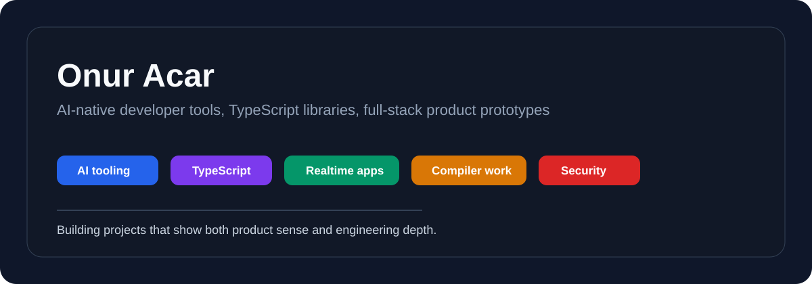

# Onur Acar

I build AI-native developer tools, TypeScript libraries, and full-stack product prototypes.

My current focus is the space where practical software engineering meets AI systems: LLM orchestration, security utilities, reactive runtimes, realtime applications, and product-shaped prototypes that can grow beyond a demo.

## Featured Work

| Project | Focus | Why it matters |
| --- | --- | --- |
| [FluxDOM](https://github.com/onuracar-dev/FluxDOM) | Compiler/runtime experiment | Custom `.flow` compiler, direct DOM generation, Vite integration, monorepo architecture |
| [llm-conductor](https://github.com/onuracar-dev/llm-conductor) | AI orchestration | Multi-provider LLM flows, Zod-backed structured outputs, TypeScript library design |
| [omniguard](https://github.com/onuracar-dev/omniguard) | Security toolkit | Validation, sanitization, hashing, JWT helpers, native Web Crypto |
| [NimbleJS](https://github.com/onuracar-dev/NimbleJs) | Reactivity | Signals, computed values, effects, stores, persistence, framework-agnostic state |
| [BuddsApp](https://github.com/onuracar-dev/buddsapp) | Realtime product | Supabase chat, LiveKit voice rooms, stories, roles, AI companion behavior |
| [WebPage Analyzer](https://github.com/onuracar-dev/WebPageAnalyz) | Audit dashboard | Lighthouse, Axe, YellowLabTools, Gemini-powered remediation notes |
| [Solar Breakdown Predict System](https://github.com/onuracar-dev/SolarBreakDownPredictSystemV2) | Operational dashboard | Solar-field monitoring, FastAPI backend, QR technician workflow, ML-oriented artifacts |

## Technical Range

- TypeScript, JavaScript, React, Vite
- Node.js, Express, Python, FastAPI
- Supabase, PostgreSQL, SQLite, realtime systems
- LLM application patterns, structured outputs, prompt workflow design
- Web Crypto, validation, sanitization, JWT utilities
- Compiler/runtime experiments and frontend architecture

## Current Direction

I am especially interested in:

- AI tooling and agentic product workflows
- startup-style full-stack engineering
- developer experience and small libraries
- systems that can move from prototype to production

## Contact

- GitHub: [onuracar-dev](https://github.com/onuracar-dev)
- Email: onuracar.work@gmail.com
