<picture>
  <source media="(prefers-color-scheme: dark)" srcset="./assets/terminal-dark.svg">
  
</picture>

## Onur Acar

Software development student in Türkiye. Frontend by degree, backend by interest.
I like small libraries with clear guarantees, compilers, and writing down what broke and why.

Everything below is live; each project runs on its own subdomain of [onuracar.dev](https://onuracar.dev).

**Writing**

- [Production Engineering Handbook](https://handbook.onuracar.dev/): 67 case studies from my own projects and open-source work. Problem, naive fixes, the actual fix, and the code. ([repo](https://github.com/onuracar-dev/production-engineering-handbook))

**Libraries**

- [FluxDOM](https://fluxdom.onuracar.dev/): experimental compiler-first `.flow` framework with direct DOM output and fine-grained reactivity. ([repo](https://github.com/onuracar-dev/FluxDOM))
- [NimbleJS](https://nimblejs.onuracar.dev/): small framework-agnostic signals and stores for TypeScript. ([repo](https://github.com/onuracar-dev/NimbleJs))
- [omniguard](https://omniguard.onuracar.dev/): validation, escaping, hashing, and HS256 JWT on Web Crypto. ([repo](https://github.com/onuracar-dev/omniguard))
- [llm-conductor](https://llm-conductor.onuracar.dev/): one typed interface for OpenAI, Anthropic, Gemini, and custom providers. ([repo](https://github.com/onuracar-dev/llm-conductor))

**Apps**

- [PixelCut](https://pixelcut.onuracar.dev/): desktop CSS studio for classrooms. Students recreate a design, the instructor watches the class live. ([repo](https://github.com/onuracar-dev/PixelCut))
- [WebPageAnalyz](https://wpa.onuracar.dev/): website audit dashboard for performance, accessibility, and SEO, with AI fix suggestions. ([repo](https://github.com/onuracar-dev/WebPageAnalyz))
- [BuddsApp](https://buddsapp.onuracar.dev/): realtime community chat with voice rooms, stories, and roles on Supabase and LiveKit. ([repo](https://github.com/onuracar-dev/buddsapp))

**Stack:** TypeScript, Node.js, Express, Python, FastAPI, React, Supabase, PostgreSQL.

[onuracar.dev](https://onuracar.dev) · onuracar.work@gmail.com
